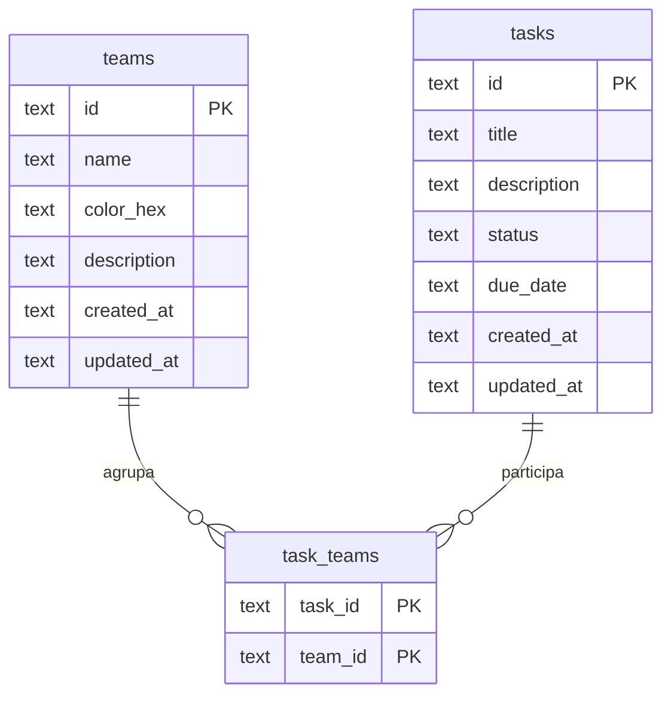

# Times e tarefas — API

API REST em Node.js e TypeScript. O app React Native está em [avaliacao-minha-claro](https://github.com/kaio1999/avaliacao-minha-claro), com o CI dele.

## Banco

O modelo é relacional: uma tarefa pode estar em vários times, ou em nenhum. Usei SQLite pelo `node:sqlite` do Node 24, num arquivo local. Sobe sem Docker, sem serviço de fora e sem compilação nativa. Em produção eu trocaria por Postgres.

O SQL está escrito na mão. São duas entidades e uma tabela de ligação, e assim o filtro, a ordenação e a paginação ficam no código que a gente lê. Cada migration é um arquivo SQL. Roda uma vez e fica registrada em `schema_migrations`.

A pasta está dividida assim:

- `src/domain.ts` — tipos do contrato e `DomainError`. Aqui não entra status HTTP
- `src/modules/*/ *.routes.ts` — rota, status e envelope
- `src/modules/shared/schemas.ts` — Zod, na entrada
- `src/modules/*/*.service.ts` — regra: time que não existe, status padrão
- `src/modules/shared/repository.ts` — SQL
- `src/db` — conexão, migration e seed

Quando a regra falha, o serviço sobe um `DomainError`. O Fastify transforma isso em 404 ou 400. O logger dele fica ligado fora dos testes.

## Modelo



`status` é `pendente`, `em_progresso` ou `concluida`. Apagar um time só desfaz o vínculo. A tarefa continua, mesmo sem time.

## Como rodar

Node.js 24 ou mais novo.

```bash
npm install
npm start
```

Na primeira subida cria `data/app.db`, roda a migration e, se ainda não houver times, aplica o seed: 3 times e 10 tarefas. Para repetir do zero:

```bash
npm run seed
```

Também tem `npm test`, `npm run typecheck` e `npm run dev`.

A API escuta em `http://localhost:3333`. `PORT` e `DATABASE_PATH` são opcionais; estão no `.env.example`. Os scripts escondem o aviso experimental do `node:sqlite`.

## Contrato

Sucesso: `{ "data": ..., "meta": { "total", "limit", "offset" } }`. `meta` só na listagem. Criar responde `201`. O resto do sucesso responde `200`.

Erro: `{ "error": { "code", "message", "details"? } }`.

| Método | Rota | Corpo / query |
| --- | --- | --- |
| GET | `/health` | — |
| GET | `/api/teams` | `limit`, `offset`, `search` |
| POST | `/api/teams` | `{ name, colorHex, description? }` |
| GET | `/api/teams/:id` | — |
| PUT | `/api/teams/:id` | campos parciais |
| DELETE | `/api/teams/:id` | — |
| GET | `/api/tasks` | `teamId`, `status`, `search`, `limit`, `offset`, `sort` |
| POST | `/api/tasks` | `{ title, description?, status?, dueDate?, teamIds? }` |
| GET | `/api/tasks/:id` | — |
| PUT | `/api/tasks/:id` | campos parciais, inclusive `{ status }` |
| DELETE | `/api/tasks/:id` | — |

`colorHex` é `#RRGGBB`. `dueDate` é `AAAA-MM-DD`. Quando o PUT manda `teamIds`, esses passam a ser os vínculos. Nome e título pedem no mínimo 3 caracteres.

`sort` aceita `createdAt`, `title`, `dueDate` e `status`, com `:asc` ou `:desc`. O padrão é `createdAt:desc`. Status ordena pendente, depois em progresso, depois concluída. `limit` padrão 20, máximo 100.

A busca da tarefa olha título, descrição e nome do time. `%` e `_` entram como texto, não como curinga.

Ids do seed, fixos:

- Design `#50B182`: `8f1c2a10-6b4e-4c3a-9d21-0a1b2c3d4e01`
- Produto `#B0A233`: `8f1c2a10-6b4e-4c3a-9d21-0a1b2c3d4e02`
- Engenharia `#66DDFB`: `8f1c2a10-6b4e-4c3a-9d21-0a1b2c3d4e03`

### Exemplos

```bash
curl.exe http://localhost:3333/api/teams

curl.exe "http://localhost:3333/api/tasks?teamId=8f1c2a10-6b4e-4c3a-9d21-0a1b2c3d4e01&status=pendente&search=chip&limit=5&offset=0&sort=title:asc"

curl.exe -X POST http://localhost:3333/api/teams -H "Content-Type: application/json" -d "{\"name\":\"Financeiro\",\"colorHex\":\"#3B8562\",\"description\":\"Fechamento mensal\"}"

curl.exe -X POST http://localhost:3333/api/tasks -H "Content-Type: application/json" -d "{\"title\":\"Planejar release\",\"status\":\"pendente\",\"teamIds\":[\"8f1c2a10-6b4e-4c3a-9d21-0a1b2c3d4e01\"]}"

curl.exe -X PUT http://localhost:3333/api/tasks/a1000000-0000-4000-8000-000000000001 -H "Content-Type: application/json" -d "{\"status\":\"concluida\"}"
```

No PowerShell, aspas simples em volta do JSON também funcionam com `curl.exe`.

## Testes

`npm test` sobe a API e bate nas rotas em `test/api.test.ts`. O `test/unit.test.ts` cobre data, busca, validação e o SQL em memória: apagar um time tira o vínculo e a tarefa fica.

`npm start` sobe a API. `npm run seed` zera o banco e recria os 3 times e as 10 tarefas.

Esta entrega para no repositório. A API escuta em qualquer interface e não tem login, então não publiquei.

## Se fosse para produção

Login por usuário, Postgres, limite de taxa e cursor no lugar do offset. O CI daqui só roda tipo e teste. Deploy seria outro workflow, separado do app. O logger que já existe daria para pendurar observabilidade em cima.
